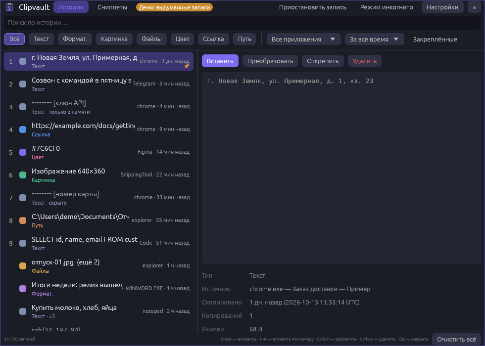
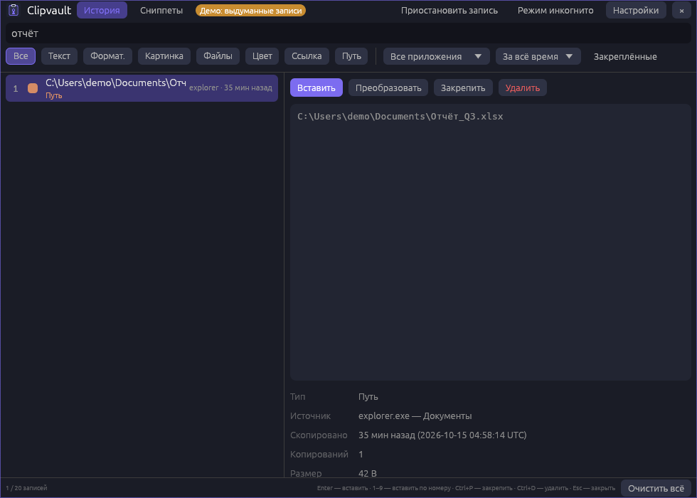
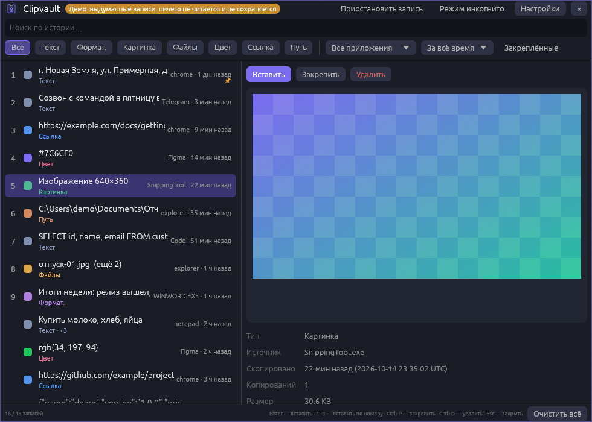
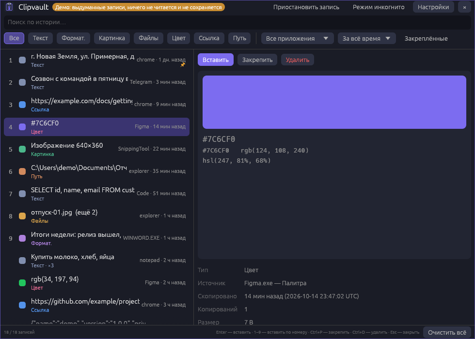
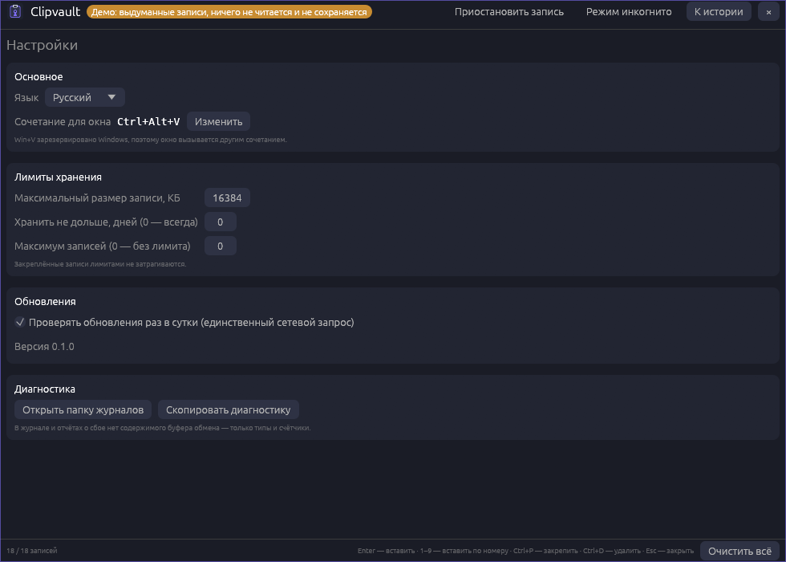

# Clipvault

[English](README.en.md) · [Русский](README.md)

A smart clipboard manager for Windows that is private by default — a replacement for Ditto and the `Win+V`
history: unlimited history with instant fuzzy search, de-duplication and **encryption on disk**. Everything
stays on your computer: no cloud, no sync, no telemetry.



*All screenshots were taken on made-up data (`Clipvault.exe --demo`) — no real clipboard entries in them.*

## What makes it different

- **The whole content is encrypted on disk** — not just a password on a file: neither the data, nor the
  metadata, nor the search index, nor temporary files are ever stored as plain text (see the
  [threat model](#privacy-and-threat-model)).
- **No keyboard hook.** The hotkey is `RegisterHotKey`, the clipboard is watched with
  `AddClipboardFormatListener`.
- **Pasting that behaves:** Clipvault gives the focus back to the window you opened the list from and presses
  `Ctrl+V` there. If that window runs as administrator Windows does not allow it (UIPI) — and the program says so.

## Features (version 0.1.0)

- **What it remembers:** text, rich text (HTML/RTF), images, file lists (`CF_HDROP`), colors (`#HEX`, `rgb()`,
  `hsl()` — with a color preview), links and paths; for each entry the program, the window title and the time.
- **De-duplication.** BLAKE3 over the normalized content; a repeat moves the entry to the top and bumps its
  copy counter instead of creating a duplicate.
- **A popup on `Ctrl+Alt+V`** (configurable; `Win+V` is reserved by Windows): instant fuzzy search as you type,
  filters by type, application and date, a preview, pasting with `Enter` or a digit `1–9`, pinning (`Ctrl+P`),
  deleting (`Ctrl+D`), "Clear all".
- **Limits:** entry size, retention period, number of entries (pinned entries are exempt).
- **Pause and "incognito mode"** — from the window and from the tray icon menu.
- **Administrator window.** The normal copy cannot paste into windows running as administrator; for those there
  is `Clipvault.exe --admin` (a button in Settings, one UAC prompt, its own hotkey `Ctrl+Alt+Shift+V`). It only
  pastes and records nothing; the main copy never runs elevated.
- **A no-admin installer**, auto-update with SHA-256 verification, a log and crash reports without clipboard
  content, a demo mode, a Russian and English interface.
- **`clipvault-cli`:** `list`, `search`, `get <id>`, `purge`.

| Search and filters | Image preview |
| --- | --- |
|  |  |

| Color | Settings |
| --- | --- |
|  |  |

Speed was measured on synthetic data (50,000 entries): fuzzy search over the whole history takes a median of
17–37 ms; details and the method are in [docs/BENCHMARKS.md](docs/BENCHMARKS.md) (Russian).

## Installation

Download `Clipvault-Setup.exe` from [Releases](https://github.com/ahsoggg-creator/clipvault/releases/latest) and
run it. No administrator rights are needed — it installs into `%LOCALAPPDATA%\Programs\Clipvault`, adds a Start
menu shortcut (optionally a desktop one) and an "Apps & features" entry. Starting with Windows is an opt-in
checkbox (off by default).

There is also a portable version — just `Clipvault.exe` (the same file); it can be installed later from Settings.
Without a window: `Clipvault-Setup.exe --install --silent`, `Clipvault.exe --uninstall --silent`.
`Clipvault.exe --background` starts in the tray without showing the window.

The tray icon (possibly under "^"): left click — the window, right click — the menu (pause, incognito, settings, exit).

### Code signing and SmartScreen

The release executables are **not signed** (GitHub Actions has no private key), so Windows may show "unknown
publisher". Check the checksums in `SHA256SUMS.txt`:

```powershell
Get-FileHash .\Clipvault-Setup.exe -Algorithm SHA256
```

The author may sign builds with a self-signed certificate locally: `scripts\make_cert.ps1` creates it (the private
key stays in the user's certificate store; `*.pfx` files are git-ignored), `scripts\release.ps1` signs the files
if the certificate exists, and `scripts\trust_cert.ps1` lets you trust it on your own computer. A self-signed
certificate proves "signed by the same author" but does not remove the SmartScreen warning by itself.

## Privacy and threat model

Clipvault sends nothing anywhere except a version check against `api.github.com` once a day (it can be turned
off in Settings; `Clipvault.exe --update` does the same by hand). No sync, no cloud, no telemetry.

**How the store works.** The folder `%APPDATA%\Clipvault` (or `CLIPVAULT_DATA_DIR`):

| File | What is inside |
| --- | --- |
| `vault.bin` | a log of XChaCha20-Poly1305 frames: entries, their metadata, images and HTML/RTF — all inside sealed frames |
| `vault.key` | a 32-byte key wrapped with DPAPI (`CryptProtectData`) for your Windows account |
| `vault.lock` | an empty lock file (the GUI and `clipvault-cli` share one vault) |
| `settings.json` | settings: language, hotkey, limits (no content) |
| `logs\` | the log and crash reports (no clipboard content) |

SQLite and SQLCipher are not used: the custom log format creates no WAL or temporary files with plain text, and
search runs on an index that is built **in memory** at start-up. Rewriting the file (on delete and "Clear all")
writes a new encrypted file and swaps it in.

**What it protects against:**

- copying or stealing the data files (a backup, another computer, another Windows account, a USB stick): without
  your Windows account's key they cannot be read;
- the content ending up in a cloud backup / indexer of the `AppData` folder as plain text;
- swapping or reordering frames inside the file (the AAD includes the file generation and the frame number).

**What it does not protect against:**

- a program running **under your account**: it can call DPAPI itself and obtain the key — as with any manager
  without a master password;
- an administrator / malware with access to the process memory (the key and decrypted entries are in
  Clipvault's memory; the page file and hibernation file are possible), keyloggers and screen capture;
- the clipboard itself: until you paste and replace it, the content sits in the Windows clipboard in the open,
  available to any program;
- metadata analysis: the size and modification time of `vault.bin`, the existence of the files;
- truncation of the log's tail (cutting off the last frames is not detected);
- remnants on an SSD: the file is rebuilt after a deletion, but old blocks with ciphertext may survive being
  overwritten (they are useless without the key).

A secrets filter (passwords, keys, seed phrases) is **not** in this version: whatever you copy goes into the
history. If you copy a password, turn on incognito mode or pause.

## Diagnostics

- `%APPDATA%\Clipvault\logs\clipvault.log` — start-up and shutdown, update and storage problems; rotated at 512 KB;
- `%APPDATA%\Clipvault\logs\crashes\crash-<time>.txt` — written on a crash: version, the **location** of the panic,
  a backtrace and the tail of the log. The panic message itself is left out on purpose: standard-library messages
  can quote the data being processed. On the next start Clipvault tells you where the report is.

Clipboard content never reaches the log or the reports — only types and counters. Settings → Diagnostics opens the
folder or copies a diagnostic text (version, entry counts per type, the log tail).

## Building

Rust (stable, edition 2024) and MSVC are required. Windows only.

```powershell
cargo build --release            # target\release\Clipvault.exe and clipvault-cli.exe
cargo test --workspace
cargo clippy --workspace --all-targets -- -D warnings
powershell -ExecutionPolicy Bypass -File scripts\e2e.ps1     # a check on a live desktop: clipboard, hotkey, paste, installer
powershell -ExecutionPolicy Bypass -File scripts\release.ps1 # checks, build, (signing), artifacts in dist\
```

Layout:

- `crates/core` — all the logic without a UI: the encrypted store, the history, de-duplication, search,
  classification, clipboard formats, settings, the localisation table; tests;
- `crates/app` — the egui GUI, the Windows listener window (clipboard, hotkey, tray), pasting, the installer,
  auto-update, diagnostics, the demo mode;
- `crates/cli` — `clipvault-cli list | search | get | purge`.

The same exe is the installer when it is named `Clipvault-Setup.exe` (or started with `--install`) and the
uninstaller with `--uninstall`.

Recreate the screenshots (made-up data, nothing real is read or written):

```powershell
Clipvault.exe --screenshots docs\screenshots
```

## License

Your choice of:

- Apache License 2.0 ([LICENSE-APACHE](LICENSE-APACHE))
- MIT license ([LICENSE-MIT](LICENSE-MIT))

Unless you explicitly state otherwise, any contribution intentionally submitted for inclusion in the work by you,
as defined in the Apache-2.0 license, shall be dual licensed as above, without any additional terms or conditions.
